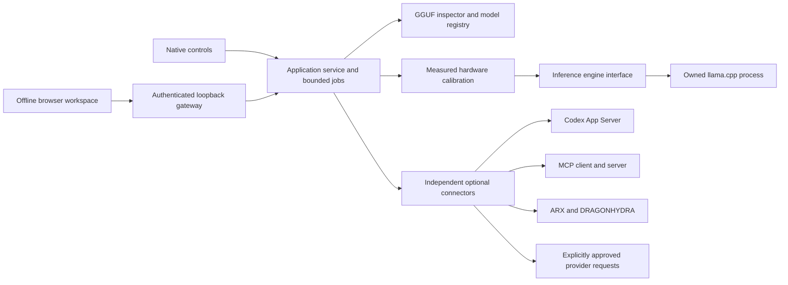

# Architecture

ABH is a self-contained .NET 8 Windows executable hosting a WinForms control panel and a loopback Kestrel gateway. Static browser assets need no CDN or internet connection. Python is not a launcher dependency.

`Models.cs` parses bounded GGUF metadata and tensor descriptors, tracks filesystem and sampled identity, caches full fingerprints, and verifies reconnection. Metadata does not confer tested capabilities. `EngineManager.cs` discovers installed/bundled runtimes, fingerprints binaries and checks conservative memory constraints. `Engine.cs` implements the lifecycle, private child authentication, readiness, metrics and shutdown. The process job closes owned children only.

`ApplicationService.cs` serializes model mutations, bounds queued jobs and inference concurrency, and records calibration measurements. The calibrator unloads the current ABH model before measuring free resources. It restores a verified candidate after failures and saves partial measurements on cancellation without starting another load.

`Gateway.cs` separates browser administration from scoped external API access. Response compatibility preserves function call IDs, arguments and results; unsupported custom/hosted tools fail explicitly. `Mcp.cs` exposes registered identities rather than arbitrary filesystem or shell access. `CodexAppServer.cs` isolates configuration and credentials from the owner's normal Codex profile.

Provider adapters preserve native request and response structures, including streamed tool fragments. Proposed tools are data; they are never executed automatically. The finite coordinator runs local/evidence workflows; it does not recursively give agents one another's credentials.

Storage uses small versioned JSON documents with atomic replacement, registry backups and an exclusive per-data-directory process lease. Unknown registry schemas are refused. `data/` contains models, profiles, conversations, logs and workflows; `vault/` contains encrypted credentials. Installed mode resolves these into writable per-user application data. Package-relative bundled model references survive relocation.
