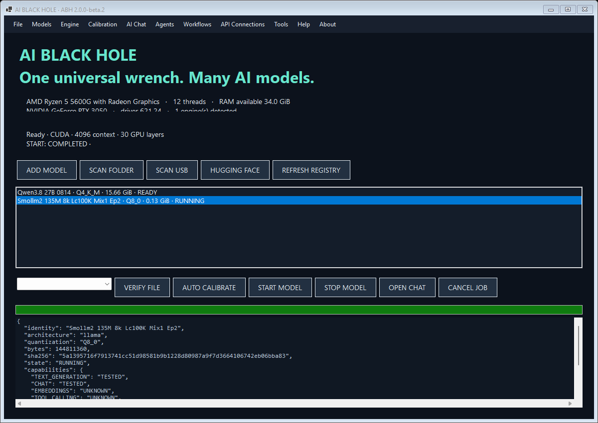
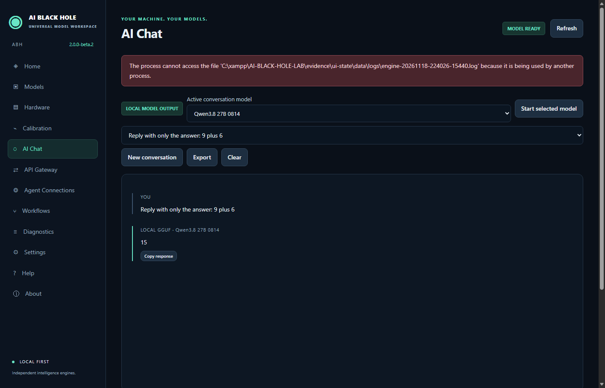

# AI BLACK HOLE · ABH

**Universal AI Model Engine and Agentic Communication Platform — 2.0.0-beta.2**

One universal wrench. Many AI models. Independent intelligence engines.

The French-wrench metaphor is an adjustable tool: ABH adapts to individually verified model and engine combinations rather than assuming every GGUF has the same capabilities.

ABH adapts its runtime configuration to a selected compatible GGUF and the available machine. Register a model where it already lives, inspect its metadata, verify its identity, calibrate bounded CPU/GPU candidates, and open local chat. The original weights stay in place.

## Start here

Download the portable archive or Windows setup from [Releases](https://github.com/chatgptopenaiagi/AI-BLACK-HOLE/releases). Extract the complete portable folder and launch **AI-BLACK-HOLE.exe**, or run the installer. The Windows x64 core includes .NET and a verified llama.cpp runtime; Python is optional for ARX only. Model weights are separate.

1. **ADD MODEL** selects a GGUF or compatible extensionless blob from an accessible drive.
2. **VERIFY FILE** records SHA-256. Later launches use cached identity with change detection.
3. **AUTO CALIBRATE** measures a small set of configurations and saves SAFE, BALANCED and FASTEST TESTED profiles.
4. **START MODEL → OPEN CHAT** starts authenticated, offline local inference.
5. Select another model and start it. ABH unloads its previous engine. **STOP MODEL** shuts down the owned process.

Use [QUICKSTART](QUICKSTART.md), [model compatibility](MODEL-COMPATIBILITY.md), [calibration](CALIBRATION.md) and [portability](PORTABILITY.md) for details.

## Evidence, not universal promises

The same ABH controls have run a Qwen-family 27B model (`qwen35`) and SmolLM2 135M (`llama`). Both produced real local text and browser responses, with externally stored weights and clean shutdown. SmolLM2's weak answers are a model-quality limitation; they do not invalidate its demonstrated runtime compatibility. Conversely, successful loading does not prove correctness or general intelligence.

See [TEST-RESULTS](TEST-RESULTS.md) and the machine-readable [reports](reports/). Results distinguish **VERIFIED**, **PARTIAL**, **BLOCKED**, **UNSUPPORTED** and **NOT TESTED**. No result establishes compatibility with every GGUF or every GPU.

## Independent connectors

The loopback API uses scoped, revocable keys. MCP works over STDIO and Streamable HTTP. The Codex App Server bridge uses the real STDIO protocol and an isolated local-provider profile. OpenAI, Claude and Grok have separate native protocol adapters and mock acceptance tests; paid connections are disabled until configured and each outbound request is approved.

ARX can run its real machine scanner through an explicitly configured isolated Python invocation, or exchange a clearly identified report. DRAGONHYDRA uses identity-checked, read-only API discovery; its unavailable services are reported honestly. Bounded workflows support local generation, machine evidence and bridge discovery. Explicit Codex and cloud handoffs remain separate user actions. See [AGENT-CONNECTORS](AGENT-CONNECTORS.md), [API](API.md) and [MCP](MCP.md).

## Beta boundaries

The verified managed inference backend is llama.cpp CPU/CUDA. Ollama, LM Studio and KoboldCpp are research/discovery references; compatible local HTTP services can be selected through the generic connector. Split GGUF loading, multimodal projector execution, audio, NPU/Vulkan acceleration and simultaneous large-model sessions are not verified. English is complete; Romanian and German localization is planned. Actual USB testing requires removable media and is distinct from fixed-disk relocation.

The application core contains no Qwen or SmolLM2 weights, credentials, private conversations or workstation logs. Hugging Face downloads select exact files and storage destinations. An optional model-inclusive package workflow verifies copied weights separately. Neither registry removal nor uninstallation deletes externally referenced models.

Owner: [chatgptopenaiagi](https://github.com/chatgptopenaiagi). ABH is an independent evolution of verified QWEN SATELLITE components, with [component provenance](research/component-provenance.json). [Architecture](ARCHITECTURE.md) · [Build](BUILD.md) · [Security](SECURITY.md) · [Roadmap](ROADMAP.md) · [Changelog](CHANGELOG.md).
